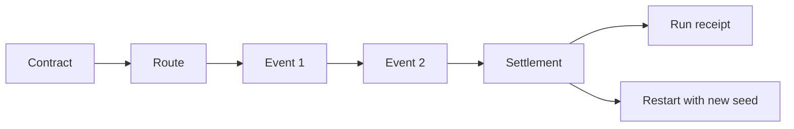

# Architecture

## 目的

このリポジトリは、ゲームの見た目を大きく作る前に、短いプレイループの判断と結果を検証できる最小構成にしています。

## 状態遷移

`SimulationState` が唯一の状態源です。各関数は現在の状態を変更せず、新しい状態を返します。

## レイヤー

| Layer | File | Responsibility |
| --- | --- | --- |
| Simulation | `src/simulation.ts` | 契約、航路、イベント、利益、seed 再現性 |
| Render | `src/game.ts` | Phaser のルート、ノード、船、貨物、イベント pulse |
| Interaction | `src/hud.ts` | DOM HUD、選択入力、event choice、receipt 表示 |
| Bootstrap | `src/main.ts` | Phaser と HUD の組み立て |

描画層は状態の phase、貨物残量、イベント数、receipt outcome を読み取り、色、貨物 crate、event pulse を更新します。バランス調整は描画コードを触らずに行えます。

## 決定性

イベントの乱数は seed、イベント番号、航路 ID から生成します。同じ seed、契約、航路、choice 列は同じイベント列になります。`RunReceipt` には選択、roll、credits、cargo、profit、reputation を保存し、結果の説明を可能にしています。

## 意図的な制限

外部アセットとネットワークを使わず、手続き描画に限定しています。これは制作速度と再現性を優先した判断です。仮説が成立した後に、アート、複雑な航路、オンライン共有を別の検証単位として追加します。
